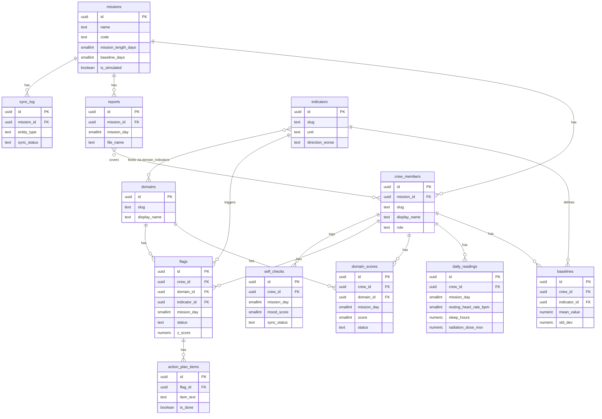

# OrbitCare — Database Design (DATABASE.md)

**Version:** 1.0 — 15 Nov 2026
**Sources of truth:** `PRD.md` v1.0 and `ARCHITECTURE.md` v1.0 (both 15 Nov 2026). If this file conflicts with either, PRD wins on what to store, ARCHITECTURE wins on how it is accessed.
**Database:** Supabase (Postgres 15+, free tier). All names are `snake_case`. All tables have `created_at` and `updated_at`. Soft delete where it makes sense (see §1.3).
**Product:** OrbitCare (working build name: Orbitspace) — offline-first astronaut health dashboard, 180-day simulated mission, 3 crew, personal-baseline anomaly detection, decision support only. Simulated data only. Not a medical device.
**Scale reality check:** the MVP is 3 crew × 180 days = 540 readings. This design is normalised and indexed for that size, and it stays correct if the crew grows to 6 or the mission extends — it is not built for millions of rows.

---

## 1. Design rules

### 1.1 Naming
- Tables: plural, `snake_case` — `crew_members`, `daily_readings`, `self_checks`.
- Columns: `snake_case` — `crew_id`, `mission_day`, `resting_heart_rate_bpm`.
- Primary keys: `id uuid` everywhere (except junction tables, which use a composite PK — see §3).
- Foreign keys: `<table_singular>_id`, e.g. `crew_id` → `crew_members.id`, `mission_id` → `missions.id`.
- Enums: `status` (`nominal` / `watch` / `alert`), `domain` (`heart` / `bone_muscle` / `sleep_mind` / `immune_radiation`), `sync_status` (`pending` / `synced` / `failed`).
- Booleans: `is_…` — `is_simulated`, `is_active`.
- Timestamps: `created_at timestamptz NOT NULL DEFAULT now()`, `updated_at timestamptz NOT NULL DEFAULT now()` on **every** table, maintained by a trigger (see §8, migration 001).

### 1.2 Normalisation (sensibly, not religiously)
- **3NF for the core:** a crew member is stored once (`crew_members`); a baseline is one row per crew × indicator (`baselines`); a reading is one row per crew × day (`daily_readings`) — never a wide table with 180 day-columns, never a name repeated in every row.
- **Derived data is stored as a cache, not as truth** (ARCHITECTURE §4): `domain_scores` and `flags` are computed from `baselines` + `daily_readings` + `self_checks`. They are stored so the Crew View can be read in one query and so a PDF can be generated from a snapshot, but they can always be recomputed. If a stored score and a recomputed score disagree, the recomputed score wins and the row is a bug.
- **One deliberate denormalisation:** `daily_readings` stores all 13 indicators in one row per crew-day (instead of one row per indicator per day). At 540 rows this is the fastest, simplest shape for charts and for the "vital | today | baseline | change" table, and it matches how the data is generated and seeded. The indicator catalogue (`indicators`) still exists as a reference table so a new indicator does not require a schema change (see §2.1).
- **No JSON blobs for data the app queries on.** `notes` on a self-check is free text (`text`, nullable) — that is the only free-text field. Everything the app filters, sorts or charts on is a typed column.

### 1.3 Soft delete
- Soft delete (`deleted_at timestamptz NULL`) where a human created the row and deleting it by mistake would lose work: `self_checks`, `action_plan_items` (check-offs), `reports`.
- **No soft delete** where the row is generated / immutable history: `daily_readings`, `domain_scores`, `flags`, `baselines`. Simulated mission history is never edited or deleted — if a reading is wrong, a new corrected row is inserted with a new `created_at`, and the old row stays for audit. `crew_members` and `missions` are soft-deleted only if a whole mission is cancelled (archive, not delete).
- Every read query in the app must filter `WHERE deleted_at IS NULL` on soft-deletable tables. The seed / admin path (service role) may read deleted rows for audit.

### 1.4 What this database does NOT store
- No real health data. All rows are simulated (`is_simulated = true` on `missions` and `daily_readings`).
- No diagnosis, no treatment, no prescriptions. The words "diagnosis" / "patient" do not appear as columns.
- No passwords, no API keys, no secrets. Auth is out of scope for the MVP (ARCHITECTURE §1.2, decision 5).
- No files / PDFs as blobs. A generated PDF is a file on the device; the database stores only its metadata (`reports` table).

---

## 2. Tables

### 2.1 Reference tables (small, seeded once)

#### `missions`
One row per mission. MVP has exactly one: the 180-day Mars transit.

| Column | Type | Constraints | Default | Notes |
|---|---|---|---|---|
| `id` | `uuid` | PK | `gen_random_uuid()` | |
| `name` | `text` | NOT NULL, unique | — | e.g. `Mars Transit 2026` |
| `code` | `text` | NOT NULL, unique | — | e.g. `MARS-2026` |
| `mission_length_days` | `smallint` | NOT NULL, CHECK `> 0 AND <= 1000` | `180` | PRD: 180 |
| `baseline_days` | `smallint` | NOT NULL, CHECK `> 0` | `21` | PRD: Days 1–21 |
| `start_date` | `date` | NULL | NULL | Mission Day 1; NULL in the demo (relative days only) |
| `is_simulated` | `boolean` | NOT NULL | `true` | Must be `true` in the MVP |
| `status` | `text` | NOT NULL, CHECK `IN ('planned','active','completed','archived')` | `'active'` | |
| `deleted_at` | `timestamptz` | NULL | NULL | Soft delete (mission cancelled) |
| `created_at` | `timestamptz` | NOT NULL | `now()` | |
| `updated_at` | `timestamptz` | NOT NULL | `now()` | |

#### `indicators`
Catalogue of every indicator the app can track. Adding a new indicator is a row, not a schema change.

| Column | Type | Constraints | Default | Notes |
|---|---|---|---|---|
| `id` | `uuid` | PK | `gen_random_uuid()` | |
| `slug` | `text` | NOT NULL, unique | — | e.g. `resting_heart_rate`, `sleep_hours` |
| `display_name` | `text` | NOT NULL | — | e.g. `Resting heart rate` |
| `unit` | `text` | NOT NULL | — | e.g. `bpm`, `h`, `ms`, `mmHg`, `kg`, `%`, `mSv` |
| `direction_worse` | `text` | NOT NULL, CHECK `IN ('higher','lower')` | — | Direction-aware z-score: `higher` = higher is worse (BP), `lower` = lower is worse (sleep, HRV) |
| `is_active` | `boolean` | NOT NULL | `true` | Inactive indicators are hidden, not deleted |
| `created_at` | `timestamptz` | NOT NULL | `now()` | |
| `updated_at` | `timestamptz` | NOT NULL | `now()` | |

Seed rows (13): `resting_heart_rate` (bpm, higher), `heart_rate_variability` (ms, lower), `systolic_bp` (mmHg, higher), `diastolic_bp` (mmHg, higher), `sleep_hours` (h, lower), `exercise_minutes` (min, lower), `body_weight_kg` (kg, lower — see note in §2.3), `grip_strength_kg` (kg, lower), `body_temperature_c` (°C, higher), `illness_symptoms` (count 0–5, higher), `mood_score` (1–5, lower), `stress_score` (1–5, higher), `reaction_time_ms` (ms, higher), `radiation_dose_msv` (mSv, higher). That is 14 rows — `radiation_dose_msv` is tracked as a cumulative dose as well as a daily dose (see `daily_readings.radiation_dose_msv` + `cumulative_radiation_dose_msv`).

#### `domains`
The 4 domain scores (PRD M4). Reference table so a domain label is never a free-text string in code.

| Column | Type | Constraints | Default | Notes |
|---|---|---|---|---|
| `id` | `uuid` | PK | `gen_random_uuid()` | |
| `slug` | `text` | NOT NULL, unique | — | `heart`, `bone_muscle`, `sleep_mind`, `immune_radiation` |
| `display_name` | `text` | NOT NULL | — | `Heart`, `Bone & Muscle`, `Sleep & Mind`, `Immune / Radiation` |
| `sort_order` | `smallint` | NOT NULL | — | 1–4, display order |
| `created_at` | `timestamptz` | NOT NULL | `now()` | |
| `updated_at` | `timestamptz` | NOT NULL | `now()` | |

#### `domain_indicators` (junction — many-to-many, see §3)
Which indicators feed which domain score. One indicator can feed more than one domain (e.g. sleep feeds Sleep & Mind and, weakly, Heart).

| Column | Type | Constraints | Default | Notes |
|---|---|---|---|---|
| `domain_id` | `uuid` | PK, FK → `domains.id` ON DELETE CASCADE | — | Part of composite PK |
| `indicator_id` | `uuid` | PK, FK → `indicators.id` ON DELETE CASCADE | — | Part of composite PK |
| `weight` | `numeric(3,2)` | NOT NULL, CHECK `> 0 AND <= 1` | `1.00` | Weight in the domain average; weights per domain sum to 1.00 in seed data |
| `created_at` | `timestamptz` | NOT NULL | `now()` | |
| `updated_at` | `timestamptz` | NOT NULL | `now()` | |

### 2.2 Core tables

#### `crew_members`
One row per astronaut. MVP: 3 rows.

| Column | Type | Constraints | Default | Notes |
|---|---|---|---|---|
| `id` | `uuid` | PK | `gen_random_uuid()` | |
| `mission_id` | `uuid` | NOT NULL, FK → `missions.id` ON DELETE CASCADE | — | |
| `slug` | `text` | NOT NULL | — | `kenji`, `amara`, `elena` — stable URL id (`/astronaut/kenji`) |
| `display_name` | `text` | NOT NULL | — | `Kenji`, `Amara`, `Elena` |
| `role` | `text` | NOT NULL | — | `Mission Specialist`, `Commander`, `Flight Engineer` |
| `avatar_initial` | `char(1)` | NOT NULL | — | `K`, `A`, `E` — DESIGN.md: initials only, no photos |
| `avatar_colour` | `text` | NOT NULL | — | DESIGN.md palette only: `#2E7FFF`, `#7FB3FF`, `#5C9DFF` |
| `is_medical_officer` | `boolean` | NOT NULL | `false` | Amara (Commander) is `true` in the seed |
| `sort_order` | `smallint` | NOT NULL | — | Display order; worst-first sorting is computed, not stored |
| `deleted_at` | `timestamptz` | NULL | NULL | Soft delete (crew removed from a mission) |
| `created_at` | `timestamptz` | NOT NULL | `now()` | |
| `updated_at` | `timestamptz` | NOT NULL | `now()` | |

Constraints: `UNIQUE (mission_id, slug)`, `UNIQUE (mission_id, display_name)`.

#### `baselines`
One row per crew member × indicator: that person's normal over Days 1–21 (mean + SD).

| Column | Type | Constraints | Default | Notes |
|---|---|---|---|---|
| `id` | `uuid` | PK | `gen_random_uuid()` | |
| `crew_id` | `uuid` | NOT NULL, FK → `crew_members.id` ON DELETE CASCADE | — | |
| `indicator_id` | `uuid` | NOT NULL, FK → `indicators.id` ON DELETE CASCADE | — | |
| `baseline_start_day` | `smallint` | NOT NULL, CHECK `>= 1` | `1` | |
| `baseline_end_day` | `smallint` | NOT NULL, CHECK `> baseline_start_day` | `21` | |
| `mean_value` | `numeric(10,3)` | NOT NULL | — | e.g. Kenji sleep 7.400 |
| `std_dev` | `numeric(10,3)` | NOT NULL, CHECK `>= 0` | — | 0 is allowed only if the indicator never varied (then z-score is 0, never divide-by-zero — see §6) |
| `sample_count` | `smallint` | NOT NULL, CHECK `> 0` | — | Days actually used, normally 21 |
| `created_at` | `timestamptz` | NOT NULL | `now()` | |
| `updated_at` | `timestamptz` | NOT NULL | `now()` | |

Constraints: `UNIQUE (crew_id, indicator_id, baseline_start_day, baseline_end_day)`. No soft delete (see §1.3).

#### `daily_readings`
One row per crew member × mission day. MVP: 3 × 180 = **540 rows**. This is the fact table — everything else is derived from it (plus `self_checks`).

| Column | Type | Constraints | Default | Notes |
|---|---|---|---|---|
| `id` | `uuid` | PK | `gen_random_uuid()` | |
| `crew_id` | `uuid` | NOT NULL, FK → `crew_members.id` ON DELETE CASCADE | — | |
| `mission_day` | `smallint` | NOT NULL, CHECK `>= 1 AND <= 1000` | — | 1–180 in the MVP |
| `resting_heart_rate_bpm` | `smallint` | NULL, CHECK `>= 30 AND <= 220` | NULL | NULL = missing that day, never 0 |
| `heart_rate_variability_ms` | `smallint` | NULL, CHECK `>= 0 AND <= 300` | NULL | |
| `systolic_bp_mmhg` | `smallint` | NULL, CHECK `>= 70 AND <= 250` | NULL | |
| `diastolic_bp_mmhg` | `smallint` | NULL, CHECK `>= 40 AND <= 150` | NULL | |
| `sleep_hours` | `numeric(4,2)` | NULL, CHECK `>= 0 AND <= 24` | NULL | |
| `exercise_minutes` | `smallint` | NULL, CHECK `>= 0 AND <= 600` | NULL | |
| `body_weight_kg` | `numeric(5,2)` | NULL, CHECK `>= 30 AND <= 200` | NULL | Direction: lower is worse only as a *loss* from baseline — see §6 |
| `grip_strength_kg` | `numeric(5,2)` | NULL, CHECK `>= 0 AND <= 150` | NULL | |
| `body_temperature_c` | `numeric(4,2)` | NULL, CHECK `>= 34 AND <= 42` | NULL | |
| `illness_symptoms` | `smallint` | NOT NULL, CHECK `>= 0 AND <= 5` | `0` | Count of symptoms that day |
| `mood_score` | `smallint` | NULL, CHECK `>= 1 AND <= 5` | NULL | 1–5, from self-check or sensor; NULL = not logged |
| `stress_score` | `smallint` | NULL, CHECK `>= 1 AND <= 5` | NULL | |
| `reaction_time_ms` | `smallint` | NULL, CHECK `>= 100 AND <= 2000` | NULL | |
| `radiation_dose_msv` | `numeric(6,3)` | NULL, CHECK `>= 0` | NULL | Daily dose |
| `cumulative_radiation_dose_msv` | `numeric(8,3)` | NULL, CHECK `>= 0` | NULL | Running total to that day |
| `data_quality` | `text` | NOT NULL, CHECK `IN ('good','partial','missing')` | `'good'` | `partial` = some indicators NULL; `missing` = no reading that day |
| `source` | `text` | NOT NULL, CHECK `IN ('simulated','sensor','manual')` | `'simulated'` | MVP: always `simulated` |
| `is_simulated` | `boolean` | NOT NULL | `true` | Must be `true` in the MVP |
| `created_at` | `timestamptz` | NOT NULL | `now()` | |
| `updated_at` | `timestamptz` | NOT NULL | `now()` | |

Constraints: `UNIQUE (crew_id, mission_day)` — one reading per person per day, enforced by the database, not by the app. No soft delete (§1.3).

#### `domain_scores`
Computed cache: one row per crew × domain × day. MVP: 3 × 4 × 180 = **2,160 rows**. Recomputable from `baselines` + `daily_readings` + `self_checks`.

| Column | Type | Constraints | Default | Notes |
|---|---|---|---|---|
| `id` | `uuid` | PK | `gen_random_uuid()` | |
| `crew_id` | `uuid` | NOT NULL, FK → `crew_members.id` ON DELETE CASCADE | — | |
| `domain_id` | `uuid` | NOT NULL, FK → `domains.id` ON DELETE CASCADE | — | |
| `mission_day` | `smallint` | NOT NULL, CHECK `>= 1 AND <= 1000` | — | |
| `score` | `smallint` | NOT NULL, CHECK `>= 0 AND <= 100` | — | 0–100; higher = healthier (PRD demo: Kenji Day 63 = 78 Watch, Day 90 = 95 Nominal) |
| `status` | `text` | NOT NULL, CHECK `IN ('nominal','watch','alert')` | — | From the smoothed z-score: Watch ≥ 1, Alert ≥ 2 (PRD M3) |
| `smoothed_z_score` | `numeric(5,2)` | NULL | NULL | 3-day smoothed average worsening z-score; NULL if not enough data |
| `reason` | `text` | NULL | NULL | One plain-language line, e.g. "Sleep and HRV below your baseline for 3 days." |
| `computed_at` | `timestamptz` | NOT NULL | `now()` | When this row was (re)computed |
| `created_at` | `timestamptz` | NOT NULL | `now()` | |
| `updated_at` | `timestamptz` | NOT NULL | `now()` | |

Constraints: `UNIQUE (crew_id, domain_id, mission_day)`. No soft delete.

#### `flags`
Computed cache: one row per alert raised. A flag is the explainable unit the UI shows — it must always have evidence + an action (PRD: "0 unexplained alerts").

| Column | Type | Constraints | Default | Notes |
|---|---|---|---|---|
| `id` | `uuid` | PK | `gen_random_uuid()` | |
| `crew_id` | `uuid` | NOT NULL, FK → `crew_members.id` ON DELETE CASCADE | — | |
| `domain_id` | `uuid` | NOT NULL, FK → `domains.id` ON DELETE CASCADE | — | |
| `indicator_id` | `uuid` | NOT NULL, FK → `indicators.id` ON DELETE CASCADE | — | The indicator that triggered the flag |
| `mission_day` | `smallint` | NOT NULL, CHECK `>= 1 AND <= 1000` | — | |
| `status` | `text` | NOT NULL, CHECK `IN ('watch','alert')` | — | Flags are only Watch/Alert; Nominal is the absence of a flag |
| `priority` | `smallint` | NOT NULL, CHECK `>= 1` | `1` | 1 = most urgent for that crew-day; Crew View sorts by this |
| `current_value` | `numeric(10,3)` | NOT NULL | — | The reading that day |
| `baseline_mean` | `numeric(10,3)` | NOT NULL | — | Copied from `baselines` at flag time, so the PDF stays correct even if a baseline is later recalculated |
| `z_score` | `numeric(5,2)` | NOT NULL | — | Direction-aware z-score (see §6) |
| `title` | `text` | NOT NULL | — | e.g. `Resting heart rate elevated` |
| `evidence_text` | `text` | NOT NULL | — | e.g. `Sleep 5.2h vs your 7.4h baseline (−1.8 SD), HRV down, mood down for 3 days.` |
| `why_it_matters` | `text` | NOT NULL | — | One sentence, plain language |
| `action_text` | `text` | NOT NULL | — | What to do now (see `action_plan_items`) |
| `contact_flight_surgeon_if` | `text` | NULL | NULL | Escalation line, e.g. `Contact the flight surgeon if fever or chest pain appears.` |
| `is_acknowledged` | `boolean` | NOT NULL | `false` | Crew has seen / acted on it |
| `acknowledged_at` | `timestamptz` | NULL | NULL | Set when `is_acknowledged` becomes `true` |
| `created_at` | `timestamptz` | NOT NULL | `now()` | |
| `updated_at` | `timestamptz` | NOT NULL | `now()` | |

Constraints: `UNIQUE (crew_id, indicator_id, mission_day)` — one flag per indicator per person per day. CHECK `acknowledged_at IS NULL OR is_acknowledged = true`. No soft delete.

#### `action_plan_items`
The checklist under a flag / action plan (PRD M5, Flow 2 step 5). One flag has many items; one item belongs to one flag.

| Column | Type | Constraints | Default | Notes |
|---|---|---|---|---|
| `id` | `uuid` | PK | `gen_random_uuid()` | |
| `flag_id` | `uuid` | NOT NULL, FK → `flags.id` ON DELETE CASCADE | — | |
| `sort_order` | `smallint` | NOT NULL | — | Display order within the flag |
| `item_text` | `text` | NOT NULL | — | e.g. `Rest today — no heavy exercise.` |
| `is_done` | `boolean` | NOT NULL | `false` | Checked off by the crew |
| `done_at` | `timestamptz` | NULL | NULL | Set when `is_done` becomes `true` |
| `deleted_at` | `timestamptz` | NULL | NULL | Soft delete (item removed from a plan) |
| `created_at` | `timestamptz` | NOT NULL | `now()` | |
| `updated_at` | `timestamptz` | NOT NULL | `now()` | |

#### `self_checks`
One row per crew member × day that they log a check-in (PRD M7). Feeds the Sleep & Mind score. A crew member logs at most once a day — enforced by a unique constraint.

| Column | Type | Constraints | Default | Notes |
|---|---|---|---|---|
| `id` | `uuid` | PK | `gen_random_uuid()` | |
| `crew_id` | `uuid` | NOT NULL, FK → `crew_members.id` ON DELETE CASCADE | — | |
| `mission_day` | `smallint` | NOT NULL, CHECK `>= 1 AND <= 1000` | — | |
| `sleep_hours` | `numeric(4,2)` | NULL, CHECK `>= 0 AND <= 24` | NULL | Required by the form (sleep + mood) — NULL only for legacy rows |
| `mood_score` | `smallint` | NULL, CHECK `>= 1 AND <= 5` | NULL | 1–5, required by the form |
| `stress_score` | `smallint` | NULL, CHECK `>= 1 AND <= 5` | NULL | 1–5, optional |
| `symptoms` | `text[]` | NOT NULL | `'{}'` | Array of symptom labels, e.g. `{'headache','fatigue'}`; empty array = none |
| `notes` | `text` | NULL | NULL | Free text, optional; never logged to error logs |
| `sync_status` | `text` | NOT NULL, CHECK `IN ('pending','synced','failed')` | `'pending'` | Offline-first: written locally as `pending`, `synced` after the API confirms |
| `synced_at` | `timestamptz` | NULL | NULL | Set when `sync_status` becomes `synced` |
| `deleted_at` | `timestamptz` | NULL | NULL | Soft delete (a check withdrawn by the astronaut) |
| `created_at` | `timestamptz` | NOT NULL | `now()` | |
| `updated_at` | `timestamptz` | NOT NULL | `now()` | |

Constraints: `UNIQUE (crew_id, mission_day)` where `deleted_at IS NULL` (partial unique index — see §5). CHECK `synced_at IS NULL OR sync_status = 'synced'`.

### 2.3 Supporting tables

#### `reports`
Metadata for a generated PDF report (PRD M8). The PDF file itself is not stored in Postgres.

| Column | Type | Constraints | Default | Notes |
|---|---|---|---|---|
| `id` | `uuid` | PK | `gen_random_uuid()` | |
| `mission_id` | `uuid` | NOT NULL, FK → `missions.id` ON DELETE CASCADE | — | |
| `mission_day` | `smallint` | NOT NULL, CHECK `>= 1 AND <= 1000` | — | The day the report covers |
| `crew_ids` | `uuid[]` | NOT NULL | — | Crew included; normally all 3 |
| `file_name` | `text` | NOT NULL | — | e.g. `OrbitCare-Day-63-report.pdf` |
| `page_count` | `smallint` | NULL, CHECK `> 0` | NULL | 4 in the MVP |
| `generated_by` | `text` | NOT NULL | `'on-device'` | MVP: always `on-device` |
| `deleted_at` | `timestamptz` | NULL | NULL | Soft delete |
| `created_at` | `timestamptz` | NOT NULL | `now()` | |
| `updated_at` | `timestamptz` | NOT NULL | `now()` | |

#### `sync_log`
Audit trail for offline → Earth sync (PRD V2 "crew handover / sync log"; in the MVP it is just a log, not a UI feature). Append-only — no updates, no soft delete.

| Column | Type | Constraints | Default | Notes |
|---|---|---|---|---|
| `id` | `uuid` | PK | `gen_random_uuid()` | |
| `mission_id` | `uuid` | NOT NULL, FK → `missions.id` ON DELETE CASCADE | — | |
| `entity_type` | `text` | NOT NULL, CHECK `IN ('self_check','report','daily_reading')` | — | What was synced |
| `entity_id` | `uuid` | NOT NULL | — | Id of the row in its table |
| `sync_status` | `text` | NOT NULL, CHECK `IN ('pending','synced','failed')` | `'pending'` | |
| `attempt_count` | `smallint` | NOT NULL | `0` | Increments per attempt; stop after 3 (ARCHITECTURE §5) |
| `last_error` | `text` | NULL | NULL | Plain-language error only; never a secret or a health value |
| `synced_at` | `timestamptz` | NULL | NULL | |
| `created_at` | `timestamptz` | NOT NULL | `now()` | |
| `updated_at` | `timestamptz` | NOT NULL | `now()` | |

#### `emergency_guide_steps` (V2 — reference data, do not seed in the MVP unless the Emergency Guide ships)
Static content for the one-tap Emergency Guide. Stored as data so the guide works offline and can be updated without a code deploy.

| Column | Type | Constraints | Default | Notes |
|---|---|---|---|---|
| `id` | `uuid` | PK | `gen_random_uuid()` | |
| `situation_slug` | `text` | NOT NULL | — | `collapsed`, `choking`, `chest_pain`, `severe_bleeding`, `burn`, `radiation_shelter` |
| `situation_name` | `text` | NOT NULL | — | e.g. `Collapsed / not breathing` |
| `step_number` | `smallint` | NOT NULL, CHECK `>= 1` | — | Order within the situation |
| `step_title` | `text` | NOT NULL | — | e.g. `Check for breathing` |
| `step_body` | `text` | NOT NULL | — | One step, plain language |
| `has_metronome` | `boolean` | NOT NULL | `false` | `true` only on the CPR step (110 bpm) |
| `is_active` | `boolean` | NOT NULL | `true` | |
| `created_at` | `timestamptz` | NOT NULL | `now()` | |
| `updated_at` | `timestamptz` | NOT NULL | `now()` | |

Constraints: `UNIQUE (situation_slug, step_number)`.

---

## 3. Relationships

| Relationship | Type | Explanation |
|---|---|---|
| `missions` → `crew_members` | **One-to-many** | One mission has many crew (3 in the MVP). A crew member belongs to exactly one mission. `crew_members.mission_id` FK, ON DELETE CASCADE. |
| `crew_members` → `baselines` | **One-to-many** | One crew member has one baseline per indicator (13–14 rows each). A baseline belongs to exactly one crew member + one indicator. |
| `crew_members` → `daily_readings` | **One-to-many** | One crew member has one reading per day (180 rows). A reading belongs to exactly one crew member. Enforced by `UNIQUE (crew_id, mission_day)`. |
| `crew_members` → `domain_scores` | **One-to-many** | One crew member has one score per domain per day (4 × 180 rows). |
| `crew_members` → `flags` | **One-to-many** | One crew member can have many flags over the mission; a flag belongs to exactly one crew member. |
| `crew_members` → `self_checks` | **One-to-many** | One crew member has at most one self-check per day. |
| `indicators` → `baselines` | **One-to-many** | One indicator has one baseline per crew member. |
| `domains` → `domain_scores` | **One-to-many** | One domain has one score per crew per day. |
| `domains` → `flags` | **One-to-many** | One domain can have many flags. |
| `indicators` → `flags` | **One-to-many** | One indicator can trigger many flags (different crew / days). |
| `domains` ↔ `indicators` | **Many-to-many** | Via `domain_indicators`. One domain is fed by many indicators; one indicator can feed many domains (with a `weight` per pair). This is the only many-to-many in the MVP. |
| `flags` → `action_plan_items` | **One-to-many** | One flag has many checklist items; an item belongs to exactly one flag. Deleting a flag deletes its items (CASCADE). |
| `missions` → `reports` | **One-to-many** | One mission has many reports (one per day generated). |
| `missions` → `sync_log` | **One-to-many** | One mission has many sync entries. |
| `crew_members` ↔ `reports` | **Many-to-many (via array, not a junction table)** | A report covers many crew; a crew member appears in many reports. In the MVP this is stored as `reports.crew_ids uuid[]` — a deliberate simplification, because a report is a snapshot, not a live relationship, and no query ever joins through it. If reports ever need per-crew queries, replace the array with a `report_crew` junction table and update this file first. |

**Cascade rules — read before deleting anything:** deleting a mission cascades to its crew, and deleting a crew member cascades to their baselines, readings, scores, flags, and self-checks. That is intentional for the demo (reset the mission = delete the mission). It is why the demo must never run against a production database, and why `daily_readings` / `flags` have no soft delete — history is either all there or the mission is gone.

---

## 4. ER diagram (Mermaid)

---

## 5. Indexes (for the most common queries)

Every query below is a real PRD flow. Indexes are listed with the query they serve; do not add an index without a query.

| Index | Columns | Serves (PRD flow) |
|---|---|---|
| `idx_daily_readings_crew_day` | `daily_readings (crew_id, mission_day)` | Dashboard + Trends for one astronaut on one day / range. **Most-used index in the app.** |
| `idx_daily_readings_day` | `daily_readings (mission_day)` | Crew View: all 3 crew on one day. |
| `idx_domain_scores_crew_day` | `domain_scores (crew_id, mission_day)` | Dashboard: 4 domain scores for one astronaut on one day. |
| `idx_domain_scores_day_status` | `domain_scores (mission_day, status)` | Crew View worst-first: who is Watch/Alert today. |
| `idx_flags_crew_day` | `flags (crew_id, mission_day)` | Dashboard + Action Plan: active flags for one astronaut on one day. |
| `idx_flags_day_status` | `flags (mission_day, status, priority)` | Crew View: all active flags today, worst first. |
| `idx_flags_unacknowledged` | `flags (crew_id, is_acknowledged)` WHERE `is_acknowledged = false` | "What still needs attention?" Partial index — only unacknowledged rows. |
| `idx_self_checks_crew_day` | `self_checks (crew_id, mission_day)` WHERE `deleted_at IS NULL` | Self-check lookup + the one-per-day unique check (partial unique index, see below). |
| `idx_self_checks_pending_sync` | `self_checks (sync_status)` WHERE `sync_status = 'pending'` | Offline sync queue: what still needs to go to Earth. |
| `idx_action_plan_items_flag` | `action_plan_items (flag_id, sort_order)` | Action Plan: items for a flag, in order. |
| `idx_baselines_crew` | `baselines (crew_id, indicator_id)` | Scoring: load one astronaut's baselines in one query. |
| `idx_crew_mission_slug` | `crew_members (mission_id, slug)` WHERE `deleted_at IS NULL` | `/astronaut/kenji` lookup. |
| `idx_reports_mission_day` | `reports (mission_id, mission_day)` | Report history for a mission day. |
| `idx_sync_log_pending` | `sync_log (sync_status, created_at)` WHERE `sync_status = 'pending'` | Sync retry queue. |

**Unique indexes (constraints, enforced by the database):**
- `daily_readings`: `UNIQUE (crew_id, mission_day)`
- `domain_scores`: `UNIQUE (crew_id, domain_id, mission_day)`
- `flags`: `UNIQUE (crew_id, indicator_id, mission_day)`
- `baselines`: `UNIQUE (crew_id, indicator_id, baseline_start_day, baseline_end_day)`
- `self_checks`: partial unique `UNIQUE (crew_id, mission_day) WHERE deleted_at IS NULL` — a soft-deleted check does not block a new check for the same day.
- `crew_members`: `UNIQUE (mission_id, slug)`, `UNIQUE (mission_id, display_name)`
- `domain_indicators`: composite PK `(domain_id, indicator_id)`

**What NOT to index:** do not index `notes` (free text), `evidence_text`, or `action_text`. Full-text search is out of scope for the MVP.

---

## 6. Scoring notes for the implementer (read before writing `lib/scoring/`)

These are database-adjacent rules — the SQL does not compute scores, the app does (ARCHITECTURE §4). The database only has to make the computation possible and auditable.

1. **Baseline:** `mean_value` + `std_dev` over Days 1–21 in `baselines`. Computed once at seed time from `daily_readings` Days 1–21. Never recompute a baseline from a later window without creating a new `baselines` row with a different `baseline_start_day`/`baseline_end_day`.
2. **Direction-aware z-score:** `z = (value − mean) / std_dev`, then flip the sign if the indicator's `direction_worse` is `'lower'` (sleep, HRV, grip strength: a *drop* is worsening). A positive z-score always means "worse". Store the flipped (worsening) z-score in `flags.z_score` and `domain_scores.smoothed_z_score`.
3. **Divide-by-zero:** if `std_dev = 0`, the z-score is `0` (no variation, no signal) — never divide by zero, never store infinity.
4. **Missing data:** if a reading is NULL, it contributes nothing to that day's domain score — it does not count as 0, and it does not drag the score down. `data_quality = 'partial'` records that. A day with no reading at all is `data_quality = 'missing'` and has no `domain_scores` row for that day.
5. **Body weight:** a *loss* from baseline is worsening; a gain is not automatically worsening. The implementer must use `|value − mean|` only on the loss side — do not treat weight as a simple `higher`/`lower` indicator. (In `indicators`, weight is listed with `direction_worse = 'lower'` as a shorthand; the scoring code must handle the loss-only rule and comment it.)
6. **Domain score:** average of the worsening z-scores of that domain's indicators (via `domain_indicators.weight`), smoothed over 3 days, then mapped to a 0–100 score and to `nominal` / `watch` / `alert` (Watch ≥ 1, Alert ≥ 2). The mapping from z-score to 0–100 must be in `lib/scoring/domains.ts` and tested — it is not a database rule.
7. **Flags copy their evidence:** `flags.baseline_mean`, `current_value` and `z_score` are copied at flag time, so a PDF generated later shows the evidence as it was, even if a baseline is recalculated.

---

## 7. Row-Level Security (RLS) — Supabase / Postgres

RLS is **enabled on every table** (`ALTER TABLE … ENABLE ROW LEVEL SECURITY`). The MVP has no auth (ARCHITECTURE §1.2, decision 5), so the MVP policies are deliberately simple — and deliberately restrictive about writes.

### MVP policies (demo, no auth)
| Table | `anon` (browser, public key) | `authenticated` | `service_role` (server only) |
|---|---|---|---|
| `missions`, `crew_members`, `indicators`, `domains`, `domain_indicators`, `baselines`, `daily_readings`, `domain_scores`, `flags`, `action_plan_items` | `SELECT` only, where `is_simulated = true` (where the column exists) and `deleted_at IS NULL` | Same as `anon` in the MVP | Full access (seed, recompute) |
| `self_checks` | `SELECT` (own crew, demo) + `INSERT` | Same as `anon` | Full access |
| `reports`, `sync_log` | `SELECT` only | `SELECT` only | Full access (insert) |
| `emergency_guide_steps` | `SELECT` only, where `is_active = true` | Same as `anon` | Full access |

**Rules in the MVP:**
- The browser key (anon) can **never** `UPDATE` or `DELETE` readings, scores, flags, or baselines. Only the service role can seed / recompute. A self-check is the only row a browser may insert — and it may only insert for the demo mission, with `is_simulated` implied by the mission.
- `deleted_at IS NULL` is part of every read policy on soft-deletable tables, so a soft-deleted row is invisible to the app even if a query forgets the filter.
- No policy ever returns a service-role key, a secret, or a row with `is_simulated = false` to the browser in the MVP.

### V2 policies (when Supabase Auth is added — do not implement now)
- Add a `profiles` table (`auth.users.id` → `crew_id`, `role`: `astronaut` / `medical_officer` / `flight_surgeon`).
- Astronaut: `SELECT` only their own crew's rows; `INSERT` only their own `self_checks`.
- Medical officer / commander: `SELECT` all crew in their mission; `UPDATE` `flags.is_acknowledged` and `action_plan_items.is_done` only.
- Flight surgeon (Earth): `SELECT` only, on missions they are assigned to, and only rows with `sync_status = 'synced'` (nothing that has not been handed over yet).
- Service role: unchanged (seed / recompute / audit).

---

## 8. Migration order

Run in this order, in Supabase SQL Editor or via `supabase/schema.sql` split into the numbered files below. Each migration is idempotent where possible (`CREATE TABLE IF NOT EXISTS`, `CREATE INDEX IF NOT EXISTS`). Never edit a migration that has already run on a shared database — write a new one.

| # | File | Contents |
|---|---|---|
| 001 | `001_extensions_and_triggers.sql` | `pgcrypto` (`gen_random_uuid()`), the `updated_at` trigger function + triggers on every table, the `set_updated_at()` helper. |
| 002 | `002_enums_and_reference.sql` | `missions`, `indicators`, `domains`, `domain_indicators` + seed rows for `indicators` (14) and `domains` (4) + `domain_indicators` weights. |
| 003 | `003_crew_and_baselines.sql` | `crew_members`, `baselines` + their unique indexes. |
| 004 | `004_daily_readings.sql` | `daily_readings` + `UNIQUE (crew_id, mission_day)` + indexes `idx_daily_readings_crew_day`, `idx_daily_readings_day`. |
| 005 | `005_domain_scores_and_flags.sql` | `domain_scores`, `flags`, `action_plan_items` + their unique indexes + flag indexes. |
| 006 | `006_self_checks.sql` | `self_checks` + partial unique index + pending-sync index. |
| 007 | `007_reports_and_sync.sql` | `reports`, `sync_log` (+ `emergency_guide_steps` as V2 — create the table now, seed it only when the Emergency Guide ships). |
| 008 | `008_indexes.sql` | Any remaining indexes from §5 not created with their tables (crew slug, baselines, reports, sync). |
| 009 | `009_rls.sql` | `ENABLE ROW LEVEL SECURITY` on every table + the MVP policies in §7. Run this **before** any seed that uses the anon key, and **after** the tables exist. |
| 010 | `010_seed_mission.sql` | Seed: 1 mission, 3 crew (Kenji / Amara / Elena), baselines, 540 readings, computed domain_scores (2,160) + flags for the injected events. In practice the seed runs from `scripts/seed-supabase.mjs` (ARCHITECTURE §3.5) using the service role — this file is the SQL equivalent for a manual run. |

**Rollback rule:** migrations 002–007 can be rolled back by dropping their tables in reverse order (007 → 002). Migration 001 (extensions/triggers) is not rolled back. Never roll back a migration that has seeded demo data without re-seeding it — the smoke test in §9 will fail.

---

## 9. Sample seed data

Seed data is simulated and labelled. These are the exact rows a reviewer should be able to check after seeding.

### `missions` (1 row)
| id | name | code | mission_length_days | baseline_days | is_simulated | status |
|---|---|---|---|---|---|---|
| (uuid) | Mars Transit 2026 | MARS-2026 | 180 | 21 | true | active |

### `crew_members` (3 rows)
| slug | display_name | role | avatar_initial | avatar_colour | is_medical_officer |
|---|---|---|---|---|---|
| kenji | Kenji | Mission Specialist | K | #2E7FFF | false |
| amara | Amara | Commander | A | #7FB3FF | true |
| elena | Elena | Flight Engineer | E | #5C9DFF | false |

### `baselines` (examples — one row per crew × indicator; Kenji's full set below, Amara/Elena follow the same shape)
Kenji, Days 1–21:

| indicator | mean_value | std_dev |
|---|---|---|
| resting_heart_rate | 62.0 | 3.1 |
| heart_rate_variability | 68.0 | 6.4 |
| systolic_bp | 118.0 | 4.2 |
| diastolic_bp | 76.0 | 3.0 |
| sleep_hours | 7.40 | 0.45 |
| exercise_minutes | 55.0 | 8.0 |
| body_weight_kg | 78.0 | 0.6 |
| grip_strength_kg | 48.0 | 2.1 |
| body_temperature_c | 36.60 | 0.20 |
| mood_score | 4.0 | 0.5 |
| stress_score | 2.0 | 0.6 |
| reaction_time_ms | 245.0 | 18.0 |
| radiation_dose_msv | 0.40 | 0.08 |

Amara: resting HR 58, HRV 72, sleep 7.8. Elena: resting HR 64, HRV 65, sleep 7.2. (Full seed rows are generated by `scripts/generate-mission-data.py` — do not hand-write all 42 baseline rows.)

### `daily_readings` (examples — 540 rows total; Day 63 is the demo)
Kenji, Day 63 (infection event — the demo story):

| mission_day | resting_heart_rate_bpm | heart_rate_variability_ms | sleep_hours | body_temperature_c | illness_symptoms | mood_score | data_quality |
|---|---|---|---|---|---|---|---|
| 63 | 74 | 52 | 5.2 | 37.40 | 2 | 2 | good |

Kenji, Day 90 (recovered): resting HR 63, HRV 66, sleep 7.3, temperature 36.6, symptoms 0, mood 4.
Amara, Day 118–131: sleep dips to ~6.1h, stress up to 4 (schedule shift). Elena: grip strength and bone-related readings decline slowly across the whole mission.

### `domain_scores` (examples)
| crew | domain | day | score | status |
|---|---|---|---|---|
| kenji | sleep_mind | 63 | 78 | watch |
| kenji | immune_radiation | 63 | 80 | watch |
| kenji | heart | 63 | 84 | watch |
| kenji | sleep_mind | 90 | 95 | nominal |
| amara | sleep_mind | 120 | 82 | watch |
| elena | bone_muscle | 150 | 85 | watch |

### `flags` (examples)
| crew | indicator | day | status | z_score | title |
|---|---|---|---|---|---|
| kenji | resting_heart_rate | 63 | watch | 1.85 | Resting heart rate elevated |
| kenji | sleep_hours | 63 | watch | -1.80* | Sleep well below your baseline |
| kenji | heart_rate_variability | 63 | watch | 1.60 | Heart rate variability low |

\* Stored z-score is the worsening (flipped) value, so sleep's stored z-score is `+1.80` — see §6, rule 2. The table above shows the raw direction for readability; the stored value is always positive-worse.

### `self_checks` (example)
| crew | mission_day | sleep_hours | mood_score | stress_score | symptoms | sync_status |
|---|---|---|---|---|---|---|
| kenji | 63 | 5.2 | 2 | 4 | {fatigue, headache} | synced |

### Row counts after a full seed (smoke-test checklist)
- `missions`: 1 · `crew_members`: 3 · `indicators`: 14 · `domains`: 4 · `domain_indicators`: ~20 · `baselines`: 42 (3 × 14) · `daily_readings`: 540 · `domain_scores`: 2,160 · `flags`: ≥ 3 on Day 63 (Kenji) · `self_checks`: 0 until a user logs one · `reports`: 0 until a PDF is generated · `sync_log`: 0 until a sync runs.

**Smoke test after seeding:** open Day 63 → Kenji worst-first, Watch, score 78, flag "Resting heart rate elevated" present with evidence + action. Open Day 90 → Kenji Nominal, score 95. Wifi off → Crew View still loads from cache.

---

## 10. What is deliberately NOT in this design

- **No `users` / `auth` table in the MVP** — no auth, no passwords, no roles table (see §7, V2).
- **No `patients`, `diagnoses`, or `treatments` tables** — forbidden by PRD.
- **No wide "one column per day" table, no JSON blob for readings, no `readings_json` column.**
- **No separate `alerts` table** — `flags` *is* the alert. Do not create a second table that duplicates it.
- **No analytics / events table in the MVP** — if product analytics are added in V2, add a table then, and update this file first.

---

*End of DATABASE.md v1.0. This file + `supabase/schema.sql` (split as in §8) are the source of truth for the database. Change the schema here first, then write the migration — never the other way round.*
